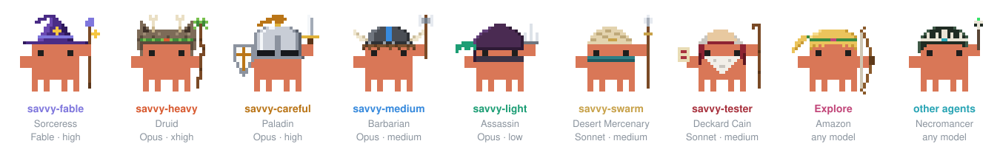

# diabolic-savvys

**[savvy-flow](plugins/savvy-flow)** and **[savvy-progress](plugins/savvy-progress)** for [Claude Code](https://claude.com/claude-code), turned into diabolic minions: an orchestrated delivery flow where every worker is a Diablo 2 hero, tuned to spend most of its time on Opus at medium effort.



A fork of [johnnyvizz/claude-kit](https://github.com/johnnyvizz/claude-kit) (MIT). The original design, the agents panel and the first seven heroes are theirs; this repo changes the tiering and adds the Sonnet heroes. See [what's different](#whats-different-from-upstream).

| Plugin | Type | What it does |
| --- | --- | --- |
| [savvy-flow](plugins/savvy-flow) | skill + agents | `/savvy-flow <task>`: the session model plans, owns design, delegates to tiered worker subagents and reviews their work. |
| [savvy-progress](plugins/savvy-progress) | mod | A progress bar above the prompt and a live agents panel where each worker walks across as its hero. |

Both work on their own and light up together: with both installed, the flow drives the bar and workers report their progress to the panel.

## The party

| Hero | Agent | Model / effort | Role |
| --- | --- | --- | --- |
| Barbarian | `savvy-medium` | Opus / medium | **Default.** Standard features, bugs with a known cause. |
| Paladin | `savvy-careful` | Opus / high | **Normal ceiling.** Delicate changes, unclear bugs, investigations. |
| Assassin | `savvy-light` | Opus / low | Mechanical edits, config, running builds and tests. |
| Desert Mercenary | `savvy-swarm` | Sonnet / medium | Narrow, fully specified tasks, fanned out in parallel waves. |
| Deckard Cain | `savvy-tester` | Sonnet / medium | Independently tests what other workers built. Never fixes code. |
| Druid | `savvy-heavy` | Opus / xhigh | Exception: only after Careful failed, or when you ask. |
| Sorceress | `savvy-fable` | Fable / high | Exception: only after Heavy failed, or when you ask. |
| Amazon | Explore agents | any | Read-only searches. |
| Necromancer | any other agent | any | Everything else. |

How the orchestrator picks between them is in [plugins/savvy-flow](plugins/savvy-flow/README.md).

## Install

> **Both plugins keep their upstream names.** If you have `savvy-flow` or `savvy-progress` from `claude-kit` installed, uninstall them first (`/plugin uninstall savvy-flow@claude-kit`, same for `savvy-progress`). Two copies with the same name cannot run side by side.

### From the marketplace

In Claude Code:

```
/plugin marketplace add the-kringel/diabolic-savvys
/plugin install savvy-flow@diabolic-savvys
/plugin install savvy-progress@diabolic-savvys
```

Then start a new session: running sessions load agents and mods only at startup. Plugin skills and agents are namespaced: the skill is `/savvy-flow:savvy-flow`, the agents `savvy-flow:savvy-medium` and so on.

### By hand

```bash
git clone https://github.com/the-kringel/diabolic-savvys.git ~/diabolic-savvys
```

**The skill and agents** (no plugin system involved, names stay short: `/savvy-flow`, `savvy-medium`):

```bash
cp -R ~/diabolic-savvys/plugins/savvy-flow/skills/savvy-flow ~/.claude/skills/
```

```bash
cp ~/diabolic-savvys/plugins/savvy-flow/agents/*.md ~/.claude/agents/
```

**The mod**, for one session:

```bash
claude --plugin-dir ~/diabolic-savvys/plugins/savvy-progress
```

or for every session (including the desktop app) through `env` in `~/.claude/settings.json`. Separate several folders with `:`, and append if the variable is already set:

```json
{
  "env": {
    "CLAUDE_CODE_PLUGIN_DIRS": "~/diabolic-savvys/plugins/savvy-progress"
  }
}
```

`git pull` in the clone updates a mod loaded this way; copied skills and agents need copying again.

The mod is built on function hooks (`hooks/register.tsx`), an early-access Claude Code API that may change between releases. If it does not show up after a marketplace install, load it by hand as above.

### Requirements

- Access to Opus and Sonnet. `savvy-fable` needs the Fable model; without it, change `model:` in [`agents/savvy-fable.md`](plugins/savvy-flow/agents/savvy-fable.md) to `opus`.
- The Sonnet workers pin `claude-sonnet-5-5`. Change `model:` in [`savvy-swarm.md`](plugins/savvy-flow/agents/savvy-swarm.md) and [`savvy-tester.md`](plugins/savvy-flow/agents/savvy-tester.md) if you want another one.

## What's different from upstream

Based on claude-kit `savvy-flow` 1.2.0 and `savvy-progress` 1.2.1. Details per release are in [CHANGELOG.md](CHANGELOG.md).

- **Tiering leans on Opus / medium.** Medium is the default tier, Careful (Opus / high) the normal ceiling including for bugs. Heavy (xhigh) and Fable are exception tiers, used only after a failure one tier below or on request. Escalation goes one tier at a time.
- **`savvy-swarm`** (Sonnet): narrow coding tasks fanned out in parallel waves of about 3–8 workers, each on its own files, reviewed by the orchestrator after every wave.
- **`savvy-tester`** (Sonnet): tests a change independently after the worker that wrote it returns; its failures become the defect list.
- **Two new heroes** in the panel: the Desert Mercenary (spear thrusts) and Deckard Cain (cane taps, Identify scroll glows).

## Customizing

Want different tiers, models or heroes? See [docs/CUSTOMIZING.md](docs/CUSTOMIZING.md).

## Layout

```
.claude-plugin/marketplace.json     the catalog `/plugin marketplace add` reads
plugins/savvy-flow/
  .claude-plugin/plugin.json        manifest
  skills/savvy-flow/SKILL.md        the orchestrator's playbook
  agents/*.md                       the workers
plugins/savvy-progress/
  .claude-plugin/plugin.json        manifest and settings
  hooks/hooks.json                  points at the hooks module
  hooks/register.tsx                the mod: bar, panel, heroes
  types/index.d.ts                  its $.state contract
docs/                               lineup image, customizing guide
```

Check before publishing: `claude plugin validate plugins/<name>`, and the catalog with `claude plugin validate .`.

## License

MIT. Copyright johnnyvizz (original work) and the-kringel (changes). See [LICENSE](LICENSE).

Diablo is a trademark of Blizzard Entertainment. This is a fan-made project, not affiliated with or endorsed by Blizzard; the heroes are original pixel art in the spirit of the game.
