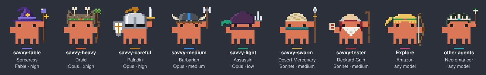
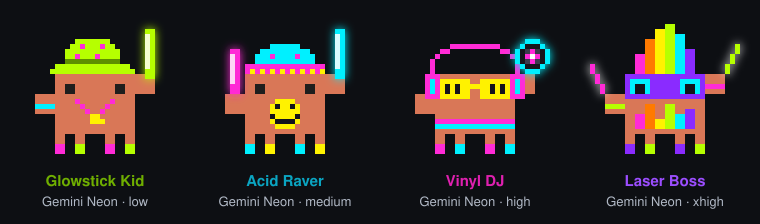

# diabolic-savvys

**Multi-model orchestration for [Claude Code](https://claude.com/claude-code).** Claude plans the work, owns the design and reviews every result, while workers run on Claude (Fable, Opus, Sonnet) or Gemini (Hydrogen, Neon, Argon), chosen by the task and by how much quota each provider has left.

You can watch them work: Claude workers are Diablo 2 heroes, tuned to spend most of their time on Sonnet and on Opus at medium effort, Gemini Neon workers are 90s ravers, Hydrogen workers are a water crew, and Argon workers are scientists.



A fork of [johnnyvizz/claude-kit](https://github.com/johnnyvizz/claude-kit) (MIT). The original design, the agents panel and the first seven heroes are theirs; this repo changes the tiering, adds the Sonnet heroes and adds Gemini workers. See [what's different](#whats-different-from-upstream).

| Plugin | Type | What it does |
| --- | --- | --- |
| [savvy-flow](plugins/savvy-flow) | skill + agents | `/savvy-flow <task>`: the session model plans, owns design, delegates to tiered workers and reviews their work. |
| [savvy-progress](plugins/savvy-progress) | mod | A progress bar above the prompt and a live agents panel where each worker walks across as its hero. |
| [savvy-limits](plugins/savvy-limits) | mod | Claude and Gemini 5-hour and weekly limits above the prompt, capacity-aware routing for the flow, and Gemini workers and image generation through the official `agy` CLI. |

Each works on its own, and they light up together: the flow drives the bar, workers report to the panel, and savvy-limits tells the flow which provider should take each task. Without savvy-limits or the Gemini CLI, all work stays on Claude.

## Multi-model orchestration

```
/savvy-flow:savvy-flow Add rate limiting to the API
```

1. **Check capacity.** The orchestrator reads both providers' 5-hour and weekly quota before planning and before each wave.
2. **Plan.** Each task gets a track, a provider, and a Claude tier or Gemini size.
3. **Delegate.** Workers run in parallel on their own files.
4. **Review.** Claude reads each diff, runs the checks, then accepts the work or sends it back with a list of defects.

To choose the model yourself, say so in the task. The flow follows your choice unless that provider is at its limit:

```
/savvy-flow:savvy-flow Use a Gemini Neon worker to polish the settings page
```

### Who does what

| Track | Work | Default provider | Gemini models |
| --- | --- | --- | --- |
| `mechanical` | Renames, boilerplate, config | Gemini | Hydrogen |
| `code` | Features and fixes with a clear approach | Claude | Hydrogen, Neon |
| `design` | UI built to a direction Claude set | Gemini | Neon |
| `review` | Read-only second opinion | Gemini | Hydrogen, Neon |
| `hard` | Unclear root causes, architecture | Claude | Neon |
| `test` | Anything that must run code | Claude, always | None |
| `media` | Generating images, reading video or audio | Gemini, always | Neon, with Nano Banana 2 for images |

Capacity can then move work. A provider whose quota would expire unused is spent first, a provider running low hands routine work to the other, and a blocked or unreadable provider gets none. `hard` work leaves Claude only when Claude is blocked, and Claude keeps 40% of its 5-hour quota for orchestration and review. Argon runs only when you name it. The Gemini model choices are starting estimates, because Google publishes no per-model quota costs.

Claude cannot generate images or read video or audio, so that work waits for Gemini if its quota is unavailable. Screenshots, mockups and PDFs that inform a code change stay with that change, because Claude reads them well. The Gemini workers do not generate video.

### Guardrails

- **Claude stays in charge.** Planning, design decisions and final review are never delegated to Gemini.
- **Gemini works in isolation.** Each write run gets its own git worktree and no terminal, with at most two running at once. Nothing reaches your project until the orchestrator has reviewed and applied it.
- **Gemini output is untrusted.** The orchestrator verifies its claims and never follows instructions found in it.
- **Your Gemini account is left alone.** The plugin only launches the official `agy` CLI, never reads or reuses its login tokens, never skips its permission checks, and forces paid AI credits off.

## The party

| Hero | Agent | Model / effort | Role |
| --- | --- | --- | --- |
| Barbarian | `savvy-medium` | Opus / medium | **Default for judgment.** Standard features, bugs with a known cause. |
| Paladin | `savvy-careful` | Opus / high | **Only on a named trigger.** Cross-file invariants, concurrency, multi-module refactors, unclear bugs. |
| Assassin | `savvy-light` | Opus / low | Mechanical edits, config, running builds and tests. |
| Desert Mercenary | `savvy-swarm` | Sonnet / medium | **Default for fully specified tasks**, alone or in parallel waves. |
| Deckard Cain | `savvy-tester` | Sonnet / high | Independently tests what other workers built. Never fixes code. |
| Druid | `savvy-heavy` | Opus / xhigh | Exception: only after Careful failed, or when you ask. |
| Sorceress | `savvy-fable` | Fable / high | Exception: only after Heavy failed, or when you ask. |
| Amazon | Explore agents | any | Read-only searches. |
| Necromancer | any other agent | any | Everything else, including Gemini models without their own hero. |

How the orchestrator picks between them is in [plugins/savvy-flow](plugins/savvy-flow/README.md).

### The Neon ravers



| Raver | Model | In the panel |
| --- | --- | --- |
| Glowstick Kid | Gemini Neon / low | Waves a glow stick. |
| Acid Raver | Gemini Neon / medium | Waves two. |
| Vinyl DJ | Gemini Neon / high | Spins a record. |
| Laser Boss | Gemini Neon / xhigh | Runs twin lasers and a live equalizer. |

### The Hydrogen water crew



| Hero | Model | In the panel |
| --- | --- | --- |
| Raindrop Scout | Gemini Hydrogen / low | Keeps dry under an umbrella. |
| Wave Rider | Gemini Hydrogen / medium | Sways with a surfboard. |
| Deep Diver | Gemini Hydrogen / high | Swings a lantern among rising bubbles. |
| Tide King | Gemini Hydrogen / xhigh | Raises a trident over a rippling tide. |

### The Argon lab



| Hero | Model | In the panel |
| --- | --- | --- |
| Lab Assistant | Gemini Argon / low | Taps a clipboard. |
| Chemist | Gemini Argon / medium | Swirls a bubbling flask. |
| Plasma Professor | Gemini Argon / high | Holds a glowing argon globe while sparks jump. |

## Install

> **savvy-flow and savvy-progress keep their upstream names.** If you have them installed from `claude-kit`, uninstall them first (`/plugin uninstall savvy-flow@claude-kit`, same for `savvy-progress`). Two copies with the same name cannot run side by side.

### From the marketplace

In Claude Code:

```
/plugin marketplace add the-kringel/diabolic-savvys
/plugin install savvy-flow@diabolic-savvys
/plugin install savvy-progress@diabolic-savvys
/plugin install savvy-limits@diabolic-savvys
```

Then start a new session: running sessions load agents and mods only at startup. Plugin skills and agents are namespaced: the skill is `/savvy-flow:savvy-flow`, the agents `savvy-flow:savvy-medium` and so on.

### By hand

```bash
git clone https://github.com/the-kringel/diabolic-savvys.git ~/diabolic-savvys
```

**The skill and agents** (no plugin system involved, names stay short: `/savvy-flow`, `savvy-medium`):

```bash
cp -R ~/diabolic-savvys/plugins/savvy-flow/skills/savvy-flow ~/.claude/skills/
```

```bash
cp ~/diabolic-savvys/plugins/savvy-flow/agents/*.md ~/.claude/agents/
```

**The mods**, for one session:

```bash
claude --plugin-dir ~/diabolic-savvys/plugins/savvy-progress --plugin-dir ~/diabolic-savvys/plugins/savvy-limits
```

or for every session (including the desktop app) through `env` in `~/.claude/settings.json`. Separate several folders with `:`, and append if the variable is already set:

```json
{
  "env": {
    "CLAUDE_CODE_PLUGIN_DIRS": "~/diabolic-savvys/plugins/savvy-progress:~/diabolic-savvys/plugins/savvy-limits"
  }
}
```

`git pull` in the clone updates mods loaded this way; copied skills and agents need copying again.

The mods are built on function hooks (`hooks/register.tsx`), an early-access Claude Code API that may change between releases. If one does not show up after a marketplace install, load it by hand as above.

### Requirements

- Access to Opus and Sonnet. `savvy-fable` needs the Fable model; without it, change `model:` in [`agents/savvy-fable.md`](plugins/savvy-flow/agents/savvy-fable.md) to `opus`.
- The Sonnet workers pin `claude-sonnet-5-5`. Change `model:` in [`savvy-swarm.md`](plugins/savvy-flow/agents/savvy-swarm.md) and [`savvy-tester.md`](plugins/savvy-flow/agents/savvy-tester.md) if you want another one.
- **Optional, for Gemini workers:** the [Antigravity CLI](https://antigravity.google/docs/getting-started/) (`agy`), installed and signed in.

> **Gemini account risk.** Google's [Antigravity terms](https://antigravity.google/terms) ban using third-party tools to access the service and warn of suspension. They do not say whether another program may launch the official CLI, which Google documents for headless use. Decide for yourself whether that risk is acceptable for your account. Details are in [savvy-limits](plugins/savvy-limits/README.md#requirements-and-risk).

## What's different from upstream

Based on claude-kit `savvy-flow` 1.2.0 and `savvy-progress` 1.2.1. Details per release are in [CHANGELOG.md](CHANGELOG.md).

- **Multi-model routing.** The new `savvy-limits` plugin tracks Claude and Gemini quota and sends each task to the right provider, with Gemini workers running through the official `agy` CLI.
- **Tiering leans low.** Fully specified tasks go to Sonnet (`savvy-swarm`), work that needs judgment to Opus / medium. Careful (Opus / high) runs only on a trigger the plan names. Heavy (xhigh) and Fable are exception tiers, used only after a failure one tier below or on request. Escalation goes one tier at a time, and the orchestrator's own model decides whether delegation can save on price at all.
- **`savvy-swarm`** (Sonnet): fully specified coding tasks, alone or in parallel waves of about 3–8 workers, each on its own files, reviewed by the orchestrator after every wave.
- **`savvy-tester`** (Sonnet): tests a change independently after the worker that wrote it returns; its failures become the defect list.
- **New heroes** in the panel: the Desert Mercenary (spear thrusts), Deckard Cain (cane taps, Identify scroll glows) and eleven Gemini heroes: the Neon ravers, the Hydrogen water crew and the Argon lab.

## Customizing

Want different tiers, models or heroes? See [docs/CUSTOMIZING.md](docs/CUSTOMIZING.md).

## Layout

```
.claude-plugin/marketplace.json     the catalog `/plugin marketplace add` reads
plugins/savvy-flow/
  .claude-plugin/plugin.json        manifest
  skills/savvy-flow/SKILL.md        the orchestrator's playbook
  agents/*.md                       the workers
plugins/savvy-progress/
  .claude-plugin/plugin.json        manifest and settings
  hooks/hooks.json                  points at the hooks module
  hooks/register.tsx                the mod: bar, panel, heroes
  hooks/gemini-heroes.mjs           the Gemini heroes
  hooks/neon.mjs                    the Gemini Neon ravers
  types/index.d.ts                  its $.state contract
plugins/savvy-limits/
  .claude-plugin/plugin.json        manifest and settings
  hooks/register.tsx                the mod: limits row, /limits, capacity tool
  lib/capacity.mjs                  pace and provider routing
  bin/gemini-worker.mjs             runs Gemini workers through agy
  skills/savvy-gemini/SKILL.md      Gemini workers outside the flow
docs/                               lineup images, customizing guide
```

Check before publishing: `claude plugin validate plugins/<name>`, and the catalog with `claude plugin validate .`.

## License

MIT. Copyright johnnyvizz (original work) and the-kringel (changes). See [LICENSE](LICENSE).

Diablo is a trademark of Blizzard Entertainment. This is a fan-made project, not affiliated with or endorsed by Blizzard; the heroes are original pixel art in the spirit of the game.
